# API Produk — ExpressJS + Prisma + PostgreSQL

Tugas Pemrograman Web Minggu 10. Lanjutan API produk Minggu 9, data kini tersimpan di database PostgreSQL (Neon) melalui Prisma ORM.

Nama: Dian Piramidiana Rachmatika
NRP: 5027251031

## Teknologi

- ExpressJS 5 + TypeScript
- Prisma ORM 7 dengan adapter Neon
- PostgreSQL (Neon)

## Cara Menjalankan

1. Install paket
   ```bash
   npm install
   ```
2. Salin `.env.example` menjadi `.env`, lalu isi dengan connection string Neon
   - `DATABASE_URL` untuk koneksi pooled (alamat dengan `-pooler`)
   - `DATABASE_URL_UNPOOLED` untuk koneksi langsung (dipakai migrasi)
3. Buat tabel, generate Prisma Client, dan isi data awal
   ```bash
   npx prisma migrate dev
   npx prisma generate
   npx prisma db seed
   ```
4. Jalankan server
   ```bash
   npm run dev
   ```
   Server berjalan di `http://localhost:3000`.

## Struktur Folder

```
images/                          screenshot dokumentasi
prisma/
├── migrations/                  riwayat perubahan struktur tabel
├── schema.prisma                desain tabel Product
└── seed.ts                      data awal (Buku, Pulpen, Spidol)
src/
├── controllers/
│   └── products.controller.ts   logika CRUD dengan Prisma
├── lib/
│   └── prisma.ts                koneksi Prisma Client ke Neon
├── middleware/
│   ├── error-handler.ts         penanganan 404 dan error terpusat
│   └── request-logger.ts        mencatat setiap request
├── routes/
│   └── products.routes.ts       pasangan method + URL ke controller
├── app.ts                       memasang middleware dan router
└── index.ts                     menjalankan server
prisma.config.ts                 konfigurasi Prisma CLI
```

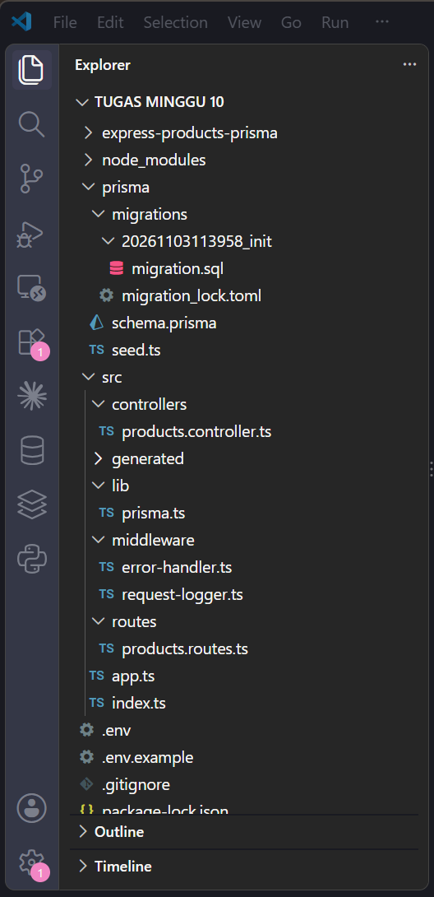

## Model Data

| Kolom | Tipe | Keterangan |
| --- | --- | --- |
| id | Int | Primary key, autoincrement |
| name | String | Wajib, tidak boleh kosong |
| price | Int | Wajib, bilangan bulat >= 0 |
| createdAt | DateTime | Otomatis saat dibuat |
| updatedAt | DateTime | Otomatis saat diubah |

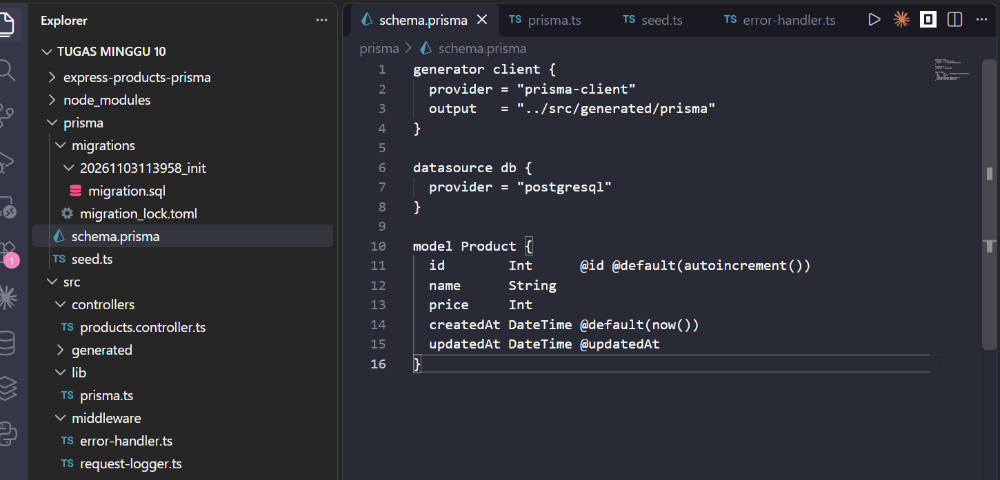

## Daftar Endpoint

| Method | URL | Body | Keterangan | Status |
| --- | --- | --- | --- | --- |
| GET | `/products` | – | Menampilkan seluruh produk | 200 |
| GET | `/products/:id` | – | Menampilkan satu produk | 200, 400, 404 |
| POST | `/products` | `{ name, price }` | Membuat produk baru | 201, 400 |
| PUT | `/products` | `{ id, name, price }` | Mengubah produk | 200, 400, 404 |
| DELETE | `/products/:id` | – | Menghapus produk | 200, 400, 404 |

## Dokumentasi

### 1. Persiapan Database

Migrasi berhasil diterapkan ke Neon dan struktur database sudah sesuai dengan schema.

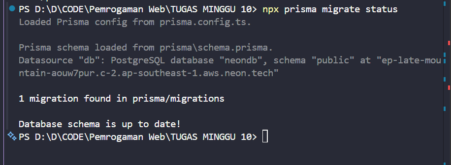

Seed sudah pernah dijalankan, sehingga tabel `Product` sudah berisi 3 data awal.

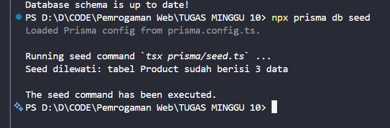

### 2. Isi Database Sebelum Pengujian

Tabel `Product` berisi 3 produk hasil seed: Buku, Pulpen, dan Spidol.

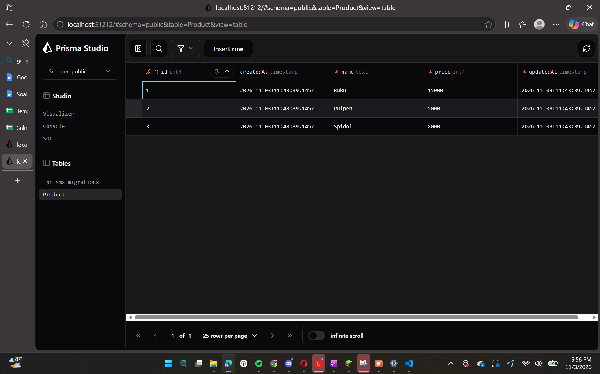

### 3. Pengujian GET

| No | Request | Hasil |
| --- | --- | --- |
| 1 | GET `/products` | 200, menampilkan 3 produk |
| 2 | GET `/products/1` | 200, menampilkan Buku |
| 3 | GET `/products/99` | 404, Produk tidak ditemukan |
| 4 | GET `/products/abc` | 400, id harus berupa angka bulat positif |

**1. GET seluruh produk (sukses)**

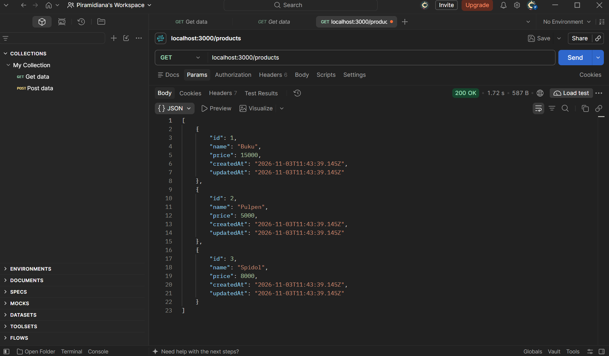

**2. GET produk berdasarkan id (sukses)**

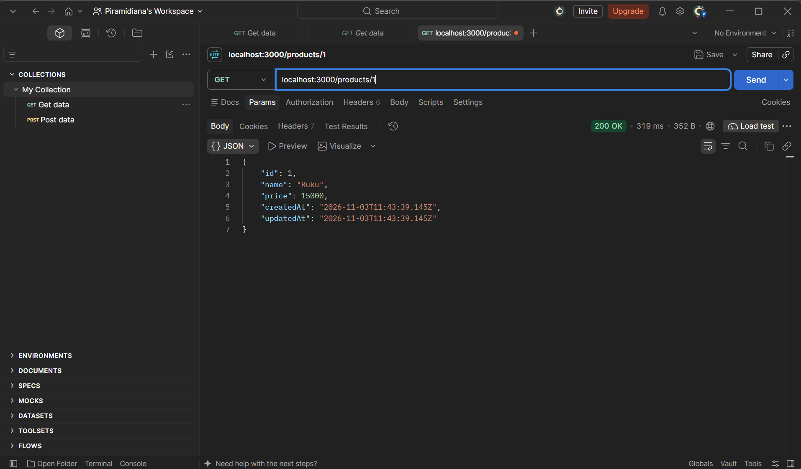

**3. GET produk yang tidak ada (gagal)**

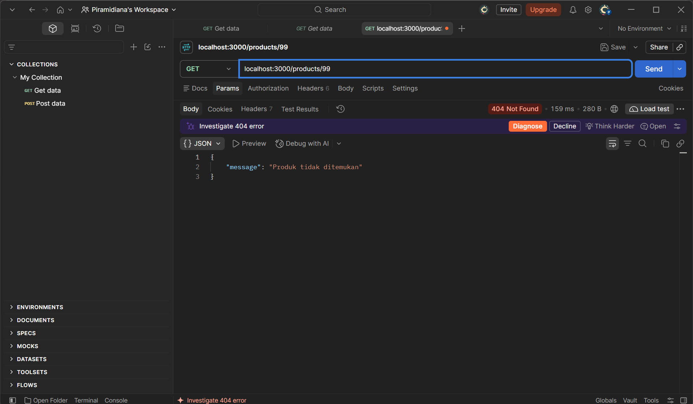

**4. GET dengan id bukan angka (gagal validasi)**

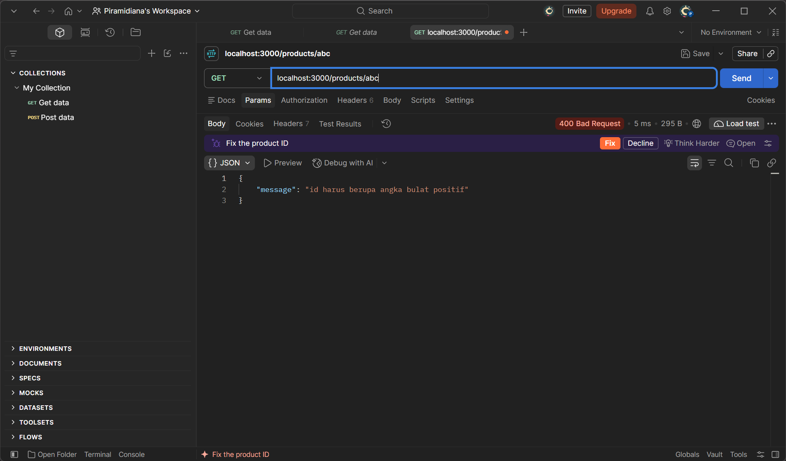

### 4. Pengujian POST

| No | Body | Hasil |
| --- | --- | --- |
| 5 | `{ "name": "Penghapus", "price": 3000 }` | 201, produk dibuat dengan id 4 |
| 6 | `{ "name": "", "price": 3000 }` | 400, name tidak boleh kosong |
| 7 | `{ "name": "Map", "price": "3000" }` | 400, price harus berupa angka |

**5. POST produk baru (sukses)**

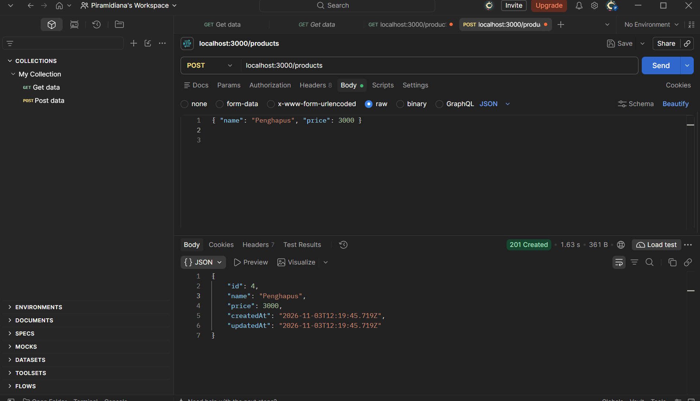

**6. POST dengan name kosong (gagal validasi)**

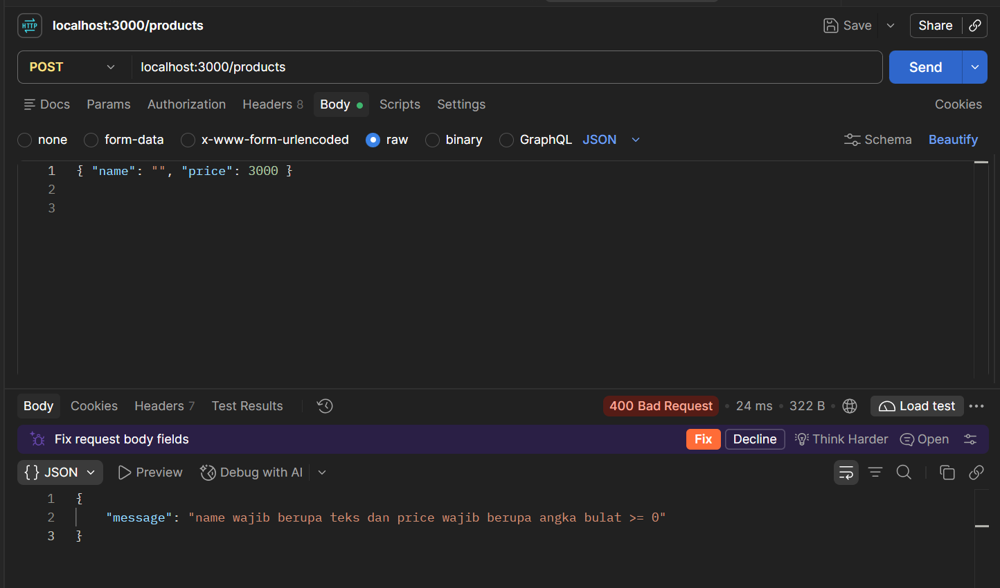

**7. POST dengan price berupa teks (gagal validasi)**

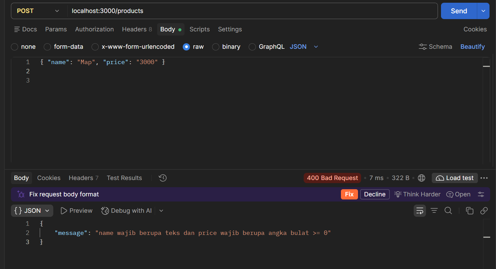

### 5. Pengujian PUT

| No | Body | Hasil |
| --- | --- | --- |
| 8 | `{ "id": 4, "name": "Penghapus Besar", "price": 4500 }` | 200, data berubah |
| 9 | `{ "id": 99, "name": "A", "price": 1000 }` | 404, Produk tidak ditemukan |
| 10 | `{ "name": "A", "price": 1000 }` | 400, id wajib diisi |

**8. PUT produk (sukses)**

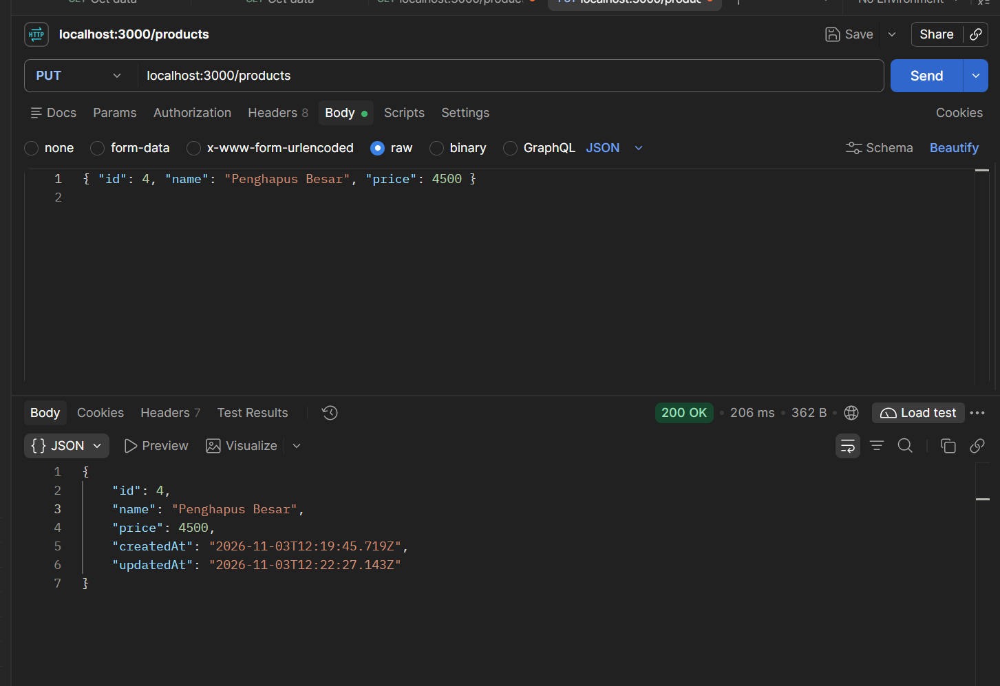

**9. PUT produk yang tidak ada (gagal)**

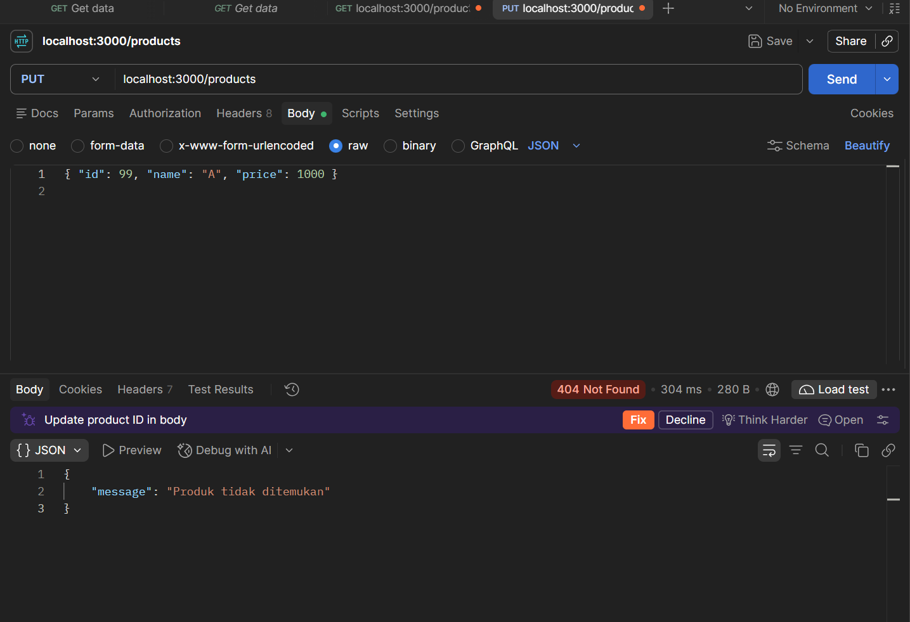

**10. PUT tanpa id (gagal validasi)**

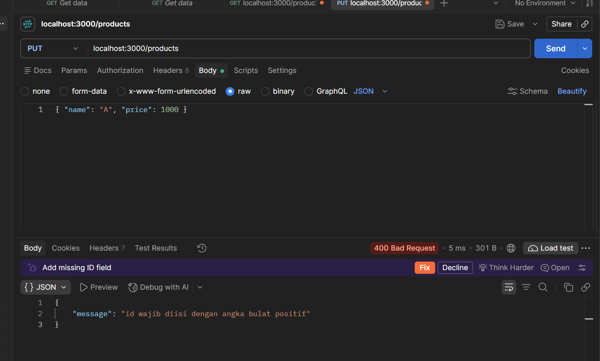

### 6. Pengujian DELETE

| No | Request | Hasil |
| --- | --- | --- |
| 11 | DELETE `/products/3` | 200, Produk berhasil dihapus |
| 12 | DELETE `/products/3` (diulang) | 404, Produk tidak ditemukan |

**11. DELETE produk (sukses)**

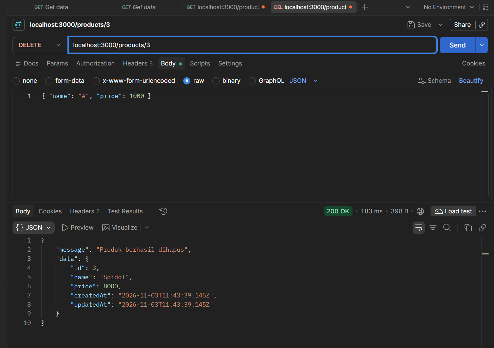

**12. DELETE produk yang sudah dihapus (gagal)**

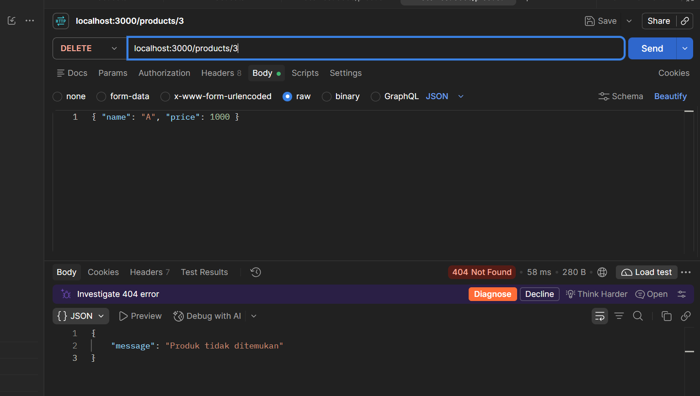

### 7. Isi Database Sesudah Pengujian

Spidol (id 3) sudah terhapus, Penghapus (id 4) sudah berubah menjadi Penghapus Besar dengan harga 4500. Kolom `updatedAt` Penghapus Besar berbeda dengan `createdAt`, menandakan data pernah diubah. Id 3 tidak dipakai ulang oleh database.

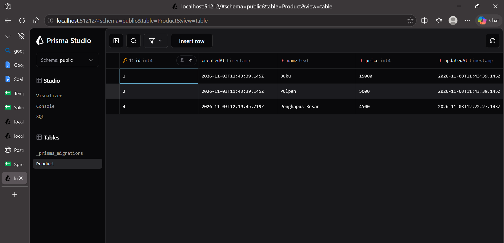

### 8. Data Tetap Tersimpan Setelah Server Di-restart

Server dimatikan lalu dijalankan kembali. Data tetap sama karena tersimpan di database, berbeda dengan Minggu 9 yang memakai array di memori sehingga data hilang setiap server di-restart.

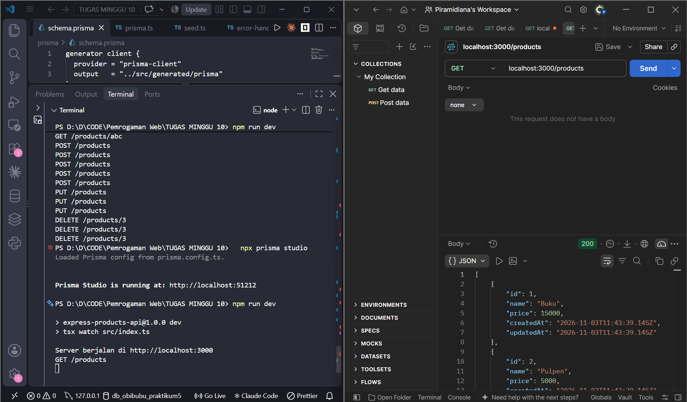